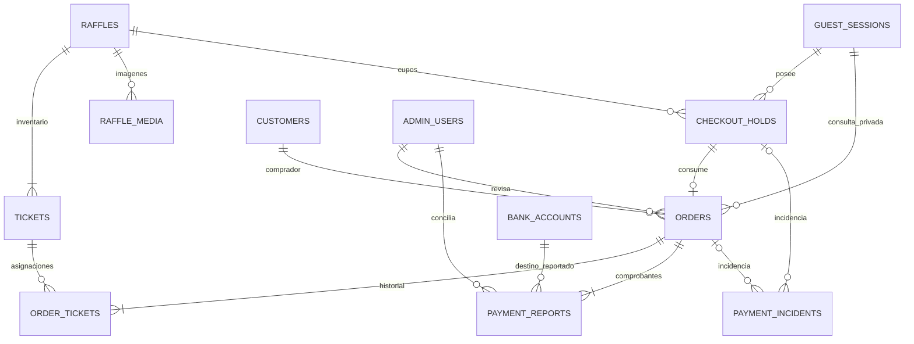

# Modelo de datos B1

Implementación en `infra/supabase/migrations/20261102010448_domain_b1.sql`.
Migración, seed, constraints, RLS y recuperación comprobados en PostgreSQL 17.5
aislado: 20 pruebas de integración aprobadas; evidencia en `ESTADO_B1.md`.

`audit_logs` referencia por UUID y nombre de entidad las escrituras anteriores;
sus actores pueden ser sistema, admin, invitado o seed. No contiene copia de PII.

| Tabla | Propósito | Restricciones principales |
|---|---|---|
| raffles | Configuración y reglas | slug único, N acotado, precio positivo, límites coherentes, fechas válidas |
| raffle_media | Referencias de imágenes propias | posición única por rifa, alt obligatorio, clave relativa |
| tickets | Estado actual de cada número | UNIQUE(raffle_id,number), rango, identidad inmutable, puntero según estado |
| guest_sessions | Pertenencia de compras invitadas | secreto hasheado único y vigencia propia; nunca equivale a orden |
| checkout_holds | Pre-reserva temporal | idempotencia por sesión, snapshot inmutable y q HELD al commit |
| customers | Contacto del comprador | teléfono E.164 sintáctico sin unicidad ni supuesto de identidad |
| orders | Snapshot contable | hold único, total generado, moneda DOP y comprobante activo obligatorio |
| order_tickets | Relación histórica | FK de rifa compuesta, asignación activa única y liberación registrada |
| payment_reports | Declaración de transferencia | path privado relativo, hash, revisión única y solo un reporte activo |
| bank_accounts | Destinos configurables | solo DOP, fixture DEMO obligatoriamente inactivo |
| admin_users | Allowlist para Auth futura | UUID externo único, un OWNER y activo=false por defecto |
| payment_incidents | Seguimiento de conciliación | al menos orden/hold, cierre exige resolución y responsable |
| audit_logs | Ledger de escrituras | append-only, requestId y actor; sin nombres, teléfono ni recibo |

## Invariantes al terminar una transacción

- N boletos exactamente en 0..N-1: creación automática, UNIQUE, rango y prohibición
  de DELETE/TRUNCATE/renumeración. No se admite VOID en B1.
- AVAILABLE no referencia hold/orden. HELD referencia solo un hold; RESERVED/SOLD,
  solo una orden de la misma rifa.
- Hold ACTIVE conserva q HELD. CONSUMED no conserva HELD y tiene una orden;
  CANCELLED/EXPIRED no tiene orden ni boletos HELD.
- Toda orden conserva su reporte y q relaciones históricas. Las órdenes pendientes
  y NEEDS_RESOLUTION mantienen q RESERVED; PAID exige q SOLD y reporte VERIFIED con
  importe exacto. No se distingue un comprobante de dinero confirmado solo por archivo.
- Cancelar exige conciliación documentada y liberación explícita de relaciones;
  el histórico sobrevive a una nueva asignación del boleto.
- Dinero en BIGINT, total calculado por DB, rango de transporte seguro a JS.

## Estados y responsabilidad por fase

| Objeto | Transiciones persistidas | Operación del servidor pendiente |
|---|---|---|
| Ticket | AVAILABLE → HELD → RESERVED → SOLD | Selección CSPRNG y bloqueos de B3/B4 |
| Hold | ACTIVE → CONSUMED / EXPIRED / CANCELLED | TTL, límites antiabuso y sesión B3 |
| Orden | Pendiente / revisión / resolución → PAID o CANCELLED | Autorización y conciliación humana B5 |
| Reporte | REPORTED, UNDER_REVIEW, VERIFIED, DISPUTED, INVALID, REFUNDED | Verificar ingreso bancario y correcciones B5 |
| Rifa | DRAFT, PUBLISHED, PAUSED, CLOSED; DRAWN bloqueado | Catálogo/admin B2 y cierre B6 |

El motor completo de transiciones y la publicación no se exponen todavía por HTTP.
No existe un job que expire órdenes. La credencial de consulta no es order_code.

## Privacidad y conexión

Todas las tablas están bajo `sorteos`, fuera de la Data API. RLS habilitado sin
políticas de cliente y permisos revocados. No hay credenciales en SQL. B2 deberá
provisionar y probar el rol de ejecución NestJS y verificar JWT contra allowlist.
El seed solo admite conexión loopback de desarrollo/prueba y genera fixtures
marcados, sin cuenta real, usuario Auth o archivo Storage real.
